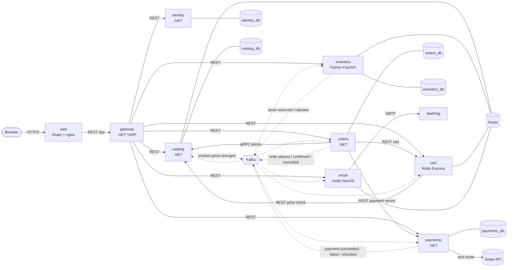

# Architecture

ecommerce-shop is eight backend services plus a React app. Every request from the browser enters through
one gateway; services talk to each other synchronously only where an answer is needed *now* (prices,
the cart, a payment record), and everything else - the whole checkout - flows as events over Kafka.

## System diagram

Solid arrows are synchronous calls (REST or gRPC). Dotted arrows are asynchronous Kafka events.



Every container writes structured JSON logs to stdout; Promtail ships them to Loki and Grafana
queries them (not drawn above to keep it readable - see [deployment.md](deployment.md#docker-compose)).

## Services

| Service | Language | Port (host / container) | Store | Responsibility |
|---|---|---|---|---|
| `web` | React 18 + nginx | 3000 / 80 | - | Storefront and admin UI; nginx proxies `/api` to the gateway |
| `gateway` | .NET 7 (YARP) | 5000 / 8080 | - | Single entry point: routing, JWT validation, rate limiting, aggregated Swagger |
| `identity` | .NET 7 | 5001 / 8080 | PostgreSQL `identity_db` | Users, roles, JWT access tokens, rotating refresh tokens |
| `catalog` | .NET 7 | 5002 / 8080, gRPC 5012 / 8081 | PostgreSQL `catalog_db`, Redis (cache) | Categories, products, search, reviews from verified buyers; gRPC server for prices |
| `orders` | .NET 7 | 5003 / 8080 | PostgreSQL `orders_db` | Order lifecycle and saga state, outbox, order-details composition, admin reports |
| `payments` | .NET 7 | 5004 / 8080 | PostgreSQL `payments_db` | Stripe test mode or mock, payment records, outbox, reconciliation and refunds |
| `inventory` | Python 3.11 (FastAPI) | 8001 / 8000 | PostgreSQL `inventory_db`, Redis (cache) | Stock levels, reservations with expiry |
| `cart` | Node 18 (Express) | 3001 / 3000 | Redis | Per-user carts |
| `email` | Node 18 (NestJS) | 3002 / 3000 | Redis (inbox only) | Notification emails via SMTP (MailHog locally) |

Host ports other than 3000 and 5000 are only published by `deploy/docker-compose.override.yml`.

## Data ownership

Each service owns its data and nobody else reads it - there are no shared tables and no cross-database
queries. When a service needs another service's data it either asks for it (sync call) or keeps its
own copy from events.

| Data | Owner | How others get it |
|---|---|---|
| Users, roles, refresh tokens | identity | JWT claims (`sub`, `email`, `role`) carried by every request |
| Products, prices, categories | catalog | gRPC `GetProductsByIds` (orders), REST (cart), `product-price-changed` events (cart) |
| Carts | cart | REST with the user's own token (orders reads and clears it at checkout) |
| Orders, status history | orders | REST; saga events |
| Stock, reservations | inventory | REST availability endpoints; saga events |
| Payment records, refunds, reconciliation runs | payments | REST (`/api/payments/orders/{id}`, admin reconciliation), saga and `payment-refunded` events |
| Reviews, verified buyers | catalog | REST; catalog learns buyers from `order-confirmed` events, never from orders' tables |
| Cancelled orders (copy) | payments | kept from `order-cancelled` so reconciliation can refund charges that raced a cancellation |
| Sent emails | email | in-memory admin view only |

Orders copies the SKU, name and unit price of each line into `order_items` at checkout, so later
catalog changes never rewrite an order. The details endpoint shows both the ordered price and the
current one.

Locally one Postgres container hosts the five databases ([init.sql](../deploy/postgres/init.sql)) and
one Redis hosts separate logical databases (inventory 0, cart 1, email 2, catalog uses its own key
prefix). In Azure the same split would be kept on managed servers.

## Event and topic catalog

All events share one JSON envelope - `eventId`, `eventType`, `schemaVersion`, `occurredAt`,
`correlationId`, `payload` ([EventEnvelope.cs](../shared/EcommerceShop.Contracts/EventEnvelope.cs)) -
and carry `correlation-id`, `event-type` and `schema-version` Kafka headers. Saga topics are keyed by
`orderId`, so one order's events stay on one partition.

| Topic | Producer | Consumers | Key |
|---|---|---|---|
| `orders.order-placed` | orders (outbox) | inventory, email | orderId |
| `orders.order-confirmed` | orders (outbox) | email, catalog | orderId |
| `orders.order-cancelled` | orders (outbox) | inventory, email, payments | orderId |
| `inventory.stock-reserved` | inventory | orders, payments | orderId |
| `inventory.stock-rejected` | inventory | orders | orderId |
| `payments.payment-succeeded` | payments (outbox) | orders, inventory | orderId |
| `payments.payment-failed` | payments (outbox) | orders, email | orderId |
| `payments.payment-refunded` | payments (outbox, from reconciliation) | email | orderId |
| `catalog.product-price-changed` | catalog | cart | productId |
| `<topic>.retry` | any consumer of `<topic>` whose handler failed | the same consumer group (`x-consumer-group` header) | original key |
| `<topic>.dlq` | any consumer, after the last retry or for a poison message | - (inspect in Kafka UI) | original key |

Payload shapes live in [Events.cs](../shared/EcommerceShop.Contracts/Events.cs); the Python and Node
services read the same camelCase JSON. Topics are created up front by
[create-topics.sh](../deploy/kafka/create-topics.sh) because broker auto-creation is disabled.

Retry and dead-letter handling is described in
[design-patterns.md](design-patterns.md#retry-topic-and-dead-letter-topic).

### What a message looks like

`orders.order-placed`, as read with `kafka-console-consumer.sh --property print.headers=true
--property print.key=true`:

```text
key: 963809ee-aabd-42b1-af2e-236cd87c19bf
headers:
event-type:OrderPlaced
schema-version:1
correlation-id:0e8c083735dc475fb4900ea986df03f9
```

```json
{
  "eventId": "7d889651-5464-4009-aa0b-ac027e3baca5",
  "eventType": "OrderPlaced",
  "schemaVersion": 1,
  "occurredAt": "2023-10-16T22:21:04.5715352+00:00",
  "correlationId": "0e8c083735dc475fb4900ea986df03f9",
  "payload": {
    "orderId": "963809ee-aabd-42b1-af2e-236cd87c19bf",
    "userId": "8e3a4d55-2c1b-4f3a-a6d4-7b9c0e1f2a02",
    "email": "customer@ecommerceshop.local",
    "items": [
      {
        "productId": "c5e86daf-d93e-5727-95ea-bcdc9a873dff",
        "sku": "B-1019",
        "name": "The Quiet Coast",
        "quantity": 2,
        "unitPrice": 14.99
      }
    ],
    "total": 29.98,
    "currency": "USD",
    "paymentMethod": "pm_card_visa"
  }
}
```

The other payloads (envelope fields left out):

`inventory.stock-reserved`

```json
{
  "orderId": "963809ee-aabd-42b1-af2e-236cd87c19bf",
  "reservationId": "88700d4d-cbd9-4228-9e2a-a7df0385d13c",
  "userId": "8e3a4d55-2c1b-4f3a-a6d4-7b9c0e1f2a02",
  "email": "customer@ecommerceshop.local",
  "total": 29.98,
  "currency": "USD",
  "paymentMethod": "pm_card_visa",
  "expiresAt": "2023-10-16T22:36:06.051221+00:00"
}
```

`payments.payment-succeeded`

```json
{
  "orderId": "963809ee-aabd-42b1-af2e-236cd87c19bf",
  "paymentId": "765f05b3-fd5d-417c-bb3c-a80ae4a2f88b",
  "amount": 29.98,
  "currency": "USD",
  "provider": "mock",
  "providerReference": "mock_pi_963809eeaabd42b1af2e236cd87c19bf"
}
```

`orders.order-confirmed`

```json
{
  "orderId": "963809ee-aabd-42b1-af2e-236cd87c19bf",
  "userId": "8e3a4d55-2c1b-4f3a-a6d4-7b9c0e1f2a02",
  "email": "customer@ecommerceshop.local",
  "total": 29.98,
  "currency": "USD",
  "items": [
    {
      "productId": "c5e86daf-d93e-5727-95ea-bcdc9a873dff",
      "sku": "B-1019",
      "name": "The Quiet Coast",
      "quantity": 2,
      "unitPrice": 14.99
    }
  ]
}
```

`payments.payment-failed`

```json
{
  "orderId": "10a33e14-8b8b-48eb-92ff-965735dca9cc",
  "paymentId": "f1019ffb-1557-4e0c-9fa3-a9715e38b5cb",
  "userId": "8e3a4d55-2c1b-4f3a-a6d4-7b9c0e1f2a02",
  "email": "customer@ecommerceshop.local",
  "amount": 14.99,
  "reason": "Your card was declined."
}
```

`orders.order-cancelled`

```json
{
  "orderId": "10a33e14-8b8b-48eb-92ff-965735dca9cc",
  "userId": "8e3a4d55-2c1b-4f3a-a6d4-7b9c0e1f2a02",
  "email": "customer@ecommerceshop.local",
  "reason": "Payment failed: Your card was declined."
}
```

`catalog.product-price-changed`

```json
{
  "productId": "35a25877-1ae7-5dcd-8c92-f25de0de1b5a",
  "sku": "B-1017",
  "oldPrice": 16.99,
  "newPrice": 18.49
}
```

`payments.payment-refunded`

```json
{
  "orderId": "a033ef3c-134b-4869-8ae9-68cd0c67f9ee",
  "paymentId": "c7539ad9-b895-4496-b531-c276f3db6e6b",
  "userId": "8e3a4d55-2c1b-4f3a-a6d4-7b9c0e1f2a02",
  "email": "customer@ecommerceshop.local",
  "amount": 129.99,
  "currency": "USD",
  "reason": "Order was cancelled (Cancelled by customer) after the payment went through.",
  "refundReference": "mock_re_a033ef3c134b48698ae968cd0c67f9ee"
}
```

`inventory.stock-rejected` carries only `{ "orderId": "...", "reason": "Insufficient stock: Card Game: Quick Wits (requested 1, available 0)" }`.
