# How it works

The main user journeys, one diagram each. Checkout is summarised here; every state and failure of
the saga is covered in [order-saga.md](order-saga.md).

## 1. Sign in and stay signed in

Identity issues a 15-minute JWT and a 7-day refresh token. The React client refreshes transparently
on a 401 ([client.ts](../react-frontend/src/api/client.ts)). Refresh tokens rotate on every use, and
replaying an old one revokes the whole family.

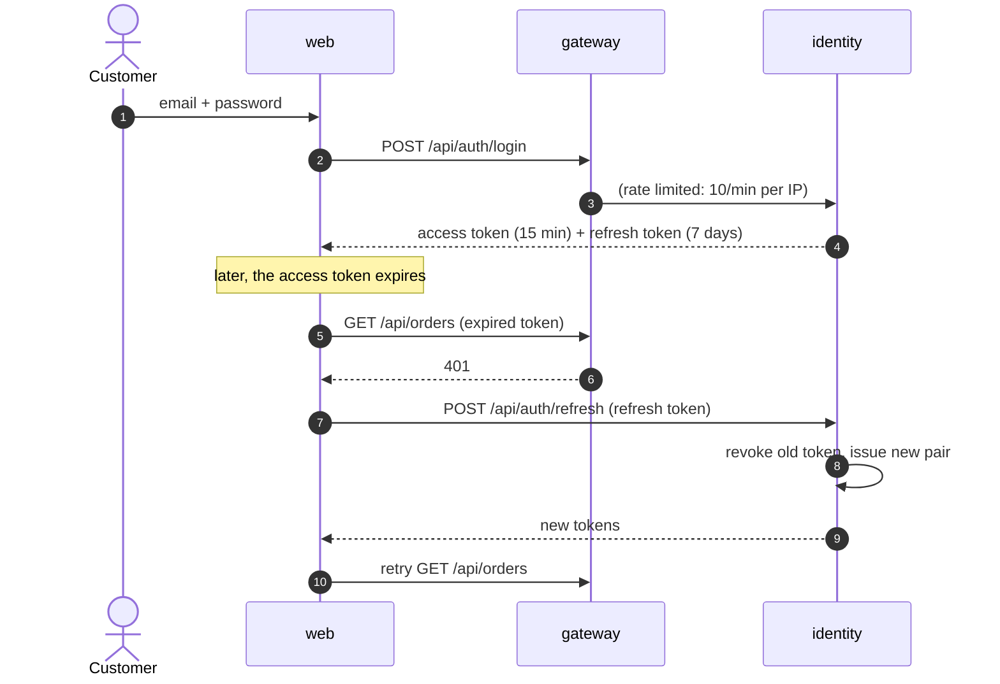

## 2. Browse and add to cart

Product reads go through **cache-aside** in catalog (Redis, 10 min TTL). Adding to the cart makes
cart call catalog for the current price, through a bulkhead → retry → circuit breaker → timeout stack.

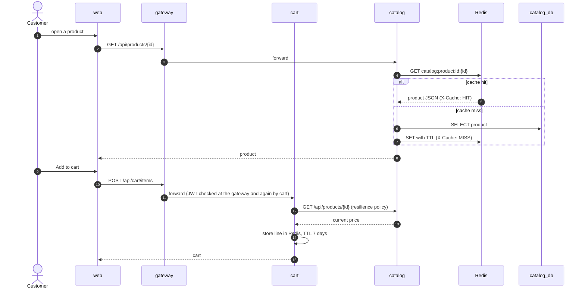

If catalog is down, the circuit opens after five consecutive failures. The cart then answers 503
immediately instead of waiting on timeouts.

## 3. Checkout - happy path (summary)

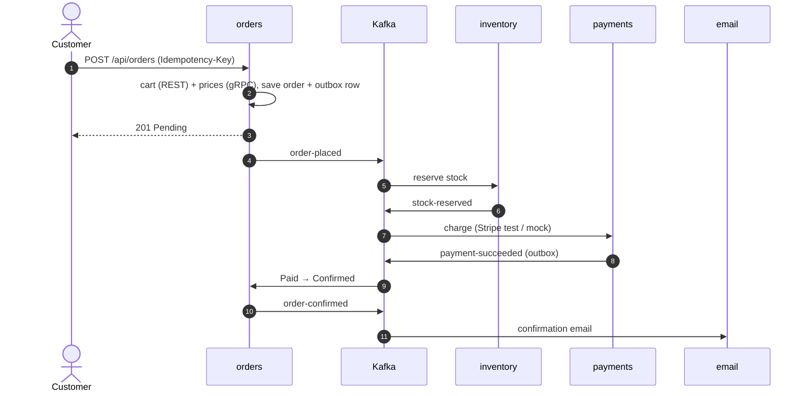

## 4. Checkout - payment declined (compensation)

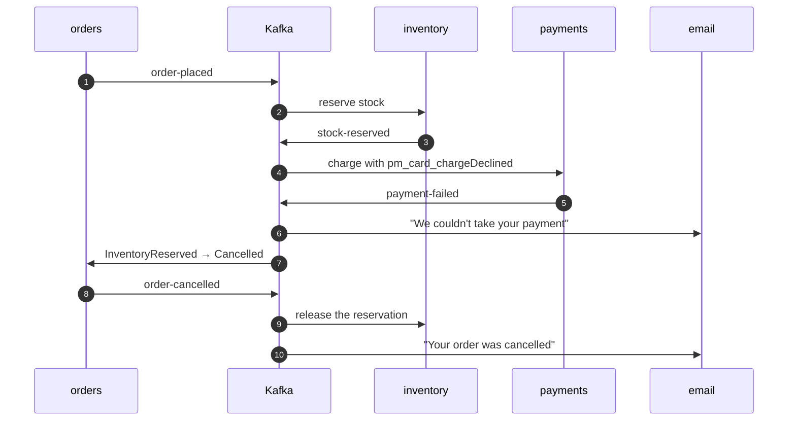

## 5. Order details - one call, three services

The order page calls `GET /api/orders/{id}/details`. Orders loads its own order, then calls payments
(REST) and catalog (gRPC) **in parallel** and merges the answers. If either dependency fails, the
page still renders, with a warning.

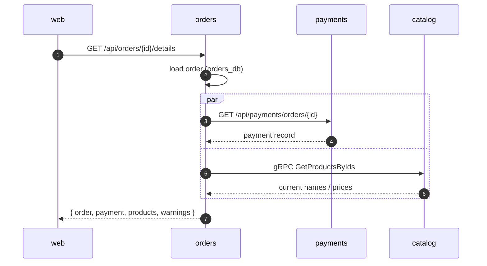

A real response for a confirmed order:

```json
{
  "order": {
    "id": "963809ee-aabd-42b1-af2e-236cd87c19bf",
    "number": "ES-231016-653760",
    "status": "Confirmed",
    "total": 29.98,
    "currency": "USD",
    "email": "customer@ecommerceshop.local",
    "paymentMethod": "pm_card_visa",
    "shippingAddress": {
      "fullName": "Casey Customer",
      "line1": "1 Main St",
      "line2": null,
      "city": "Springfield",
      "postalCode": "12345",
      "country": "US"
    },
    "items": [
      {
        "productId": "c5e86daf-d93e-5727-95ea-bcdc9a873dff",
        "sku": "B-1019",
        "name": "The Quiet Coast",
        "quantity": 2,
        "unitPrice": 14.99,
        "lineTotal": 29.98,
        "imageUrl": "https://picsum.photos/seed/the-quiet-coast/640/480"
      }
    ],
    "timeline": [
      {
        "from": null,
        "to": "Pending",
        "note": "Order placed",
        "occurredAt": "2023-10-16T22:21:04.569623+00:00"
      },
      {
        "from": "Pending",
        "to": "InventoryReserved",
        "note": "Stock reserved",
        "occurredAt": "2023-10-16T22:21:06.195121+00:00"
      },
      {
        "from": "InventoryReserved",
        "to": "Paid",
        "note": "Payment captured",
        "occurredAt": "2023-10-16T22:21:08.287226+00:00"
      },
      {
        "from": "Paid",
        "to": "Confirmed",
        "note": "Order confirmed",
        "occurredAt": "2023-10-16T22:21:08.287228+00:00"
      }
    ],
    "cancellationReason": null,
    "canCancel": false,
    "createdAt": "2023-10-16T22:21:04.569606+00:00",
    "updatedAt": "2023-10-16T22:21:08.287228+00:00",
    "priceAdjustments": null
  },
  "payment": {
    "id": "765f05b3-fd5d-417c-bb3c-a80ae4a2f88b",
    "orderId": "963809ee-aabd-42b1-af2e-236cd87c19bf",
    "amount": 29.98,
    "currency": "USD",
    "provider": "mock",
    "status": "Succeeded",
    "failureReason": null,
    "providerReference": "mock_pi_963809eeaabd42b1af2e236cd87c19bf",
    "createdAt": "2023-10-16T22:21:06.183977+00:00"
  },
  "products": [
    {
      "productId": "c5e86daf-d93e-5727-95ea-bcdc9a873dff",
      "orderedName": "The Quiet Coast",
      "orderedUnitPrice": 14.99,
      "quantity": 2,
      "currentName": "The Quiet Coast",
      "currentPrice": 14.99,
      "imageUrl": "https://picsum.photos/seed/the-quiet-coast/640/480",
      "stillAvailable": true
    }
  ],
  "warnings": []
}
```

If payments is down, `payment` is `null` and `warnings` says so; the order itself still comes back.

## 6. A price changes

When an admin edits a price, catalog invalidates the cached product and publishes
`product-price-changed` with the **new price in the event**. Cart flags the line in every cart that
holds the product, without calling catalog back. The customer sees "now $x" in the cart, and checkout
always charges the catalog price.

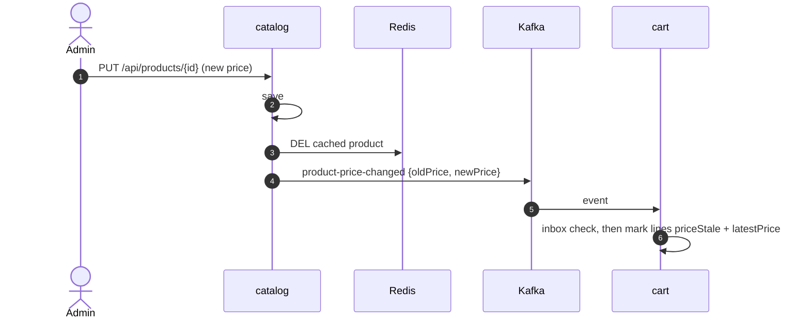

The event catalog published after an admin raised *Night Garden* from 16.99 to 18.49:

```json
{
  "eventId": "f781f24c-6e3a-4e81-9bee-d88cc15b258b",
  "eventType": "ProductPriceChanged",
  "schemaVersion": 1,
  "occurredAt": "2023-10-16T22:24:18.6177359+00:00",
  "correlationId": "22b19fad555843d38c2a6a77943a077e",
  "payload": {
    "productId": "35a25877-1ae7-5dcd-8c92-f25de0de1b5a",
    "sku": "B-1017",
    "oldPrice": 16.99,
    "newPrice": 18.49
  }
}
```

The cart line it touched (`GET /api/cart`):

```json
{
  "productId": "35a25877-1ae7-5dcd-8c92-f25de0de1b5a",
  "sku": "B-1017",
  "name": "Night Garden",
  "imageUrl": "https://picsum.photos/seed/night-garden/640/480",
  "unitPrice": 16.99,
  "quantity": 1,
  "priceStale": true,
  "addedAt": "2023-10-16T22:24:11.151Z",
  "latestPrice": 18.49
}
```

## 7. Review a product

Only customers who bought a product can review it, and catalog decides that on its own: it consumes
`orders.order-confirmed`, whose payload carries the order lines, and remembers `(user, product)` pairs
in `verified_purchases`.

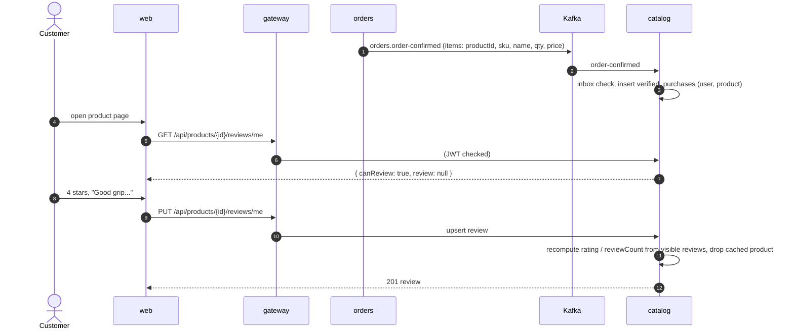

A customer who has not bought the product gets `canReview: false`, and a PUT anyway is refused:

```json
{
  "type": "https://tools.ietf.org/html/rfc7231#section-6.5.3",
  "title": "Forbidden",
  "status": 403,
  "detail": "Only customers who bought this product can review it.",
  "instance": "/api/products/b09a7e72-39b3-559c-8e31-f7549f90dbf5/reviews/me",
  "correlationId": "c0470b35a6f44049af3d442186039cce"
}
```

There is one review per customer and product (unique index), so a second PUT edits it. Admins can
hide a review from **Admin → Reviews**; a hidden review leaves the public list and the average, and
its author sees "(hidden by a moderator)" next to it.

## 8. Reconciliation and refunds

The saga can't stop every bad charge. If payments is slow, the reservation can expire, or the customer
can cancel, while the charge is still on its way; orders then ignores the late `payment-succeeded`.
Payments keeps its own list of cancelled orders (from `orders.order-cancelled`), and every 15 minutes
a reconciliation run compares the last 7 days of payments with the provider and with that list.

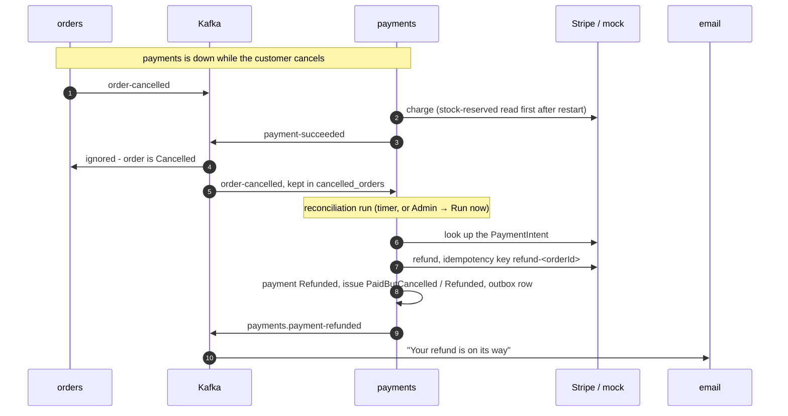

What one real run found (`POST /api/payments/reconciliation/runs`):

```json
{
  "id": "010c1522-ae70-4fd3-84e6-aa80ec6dc7fd",
  "paymentId": "c7539ad9-b895-4496-b531-c276f3db6e6b",
  "orderId": "a033ef3c-134b-4869-8ae9-68cd0c67f9ee",
  "kind": "PaidButCancelled",
  "resolution": "Refunded",
  "detail": "Order was cancelled (Cancelled by customer) after the payment went through.",
  "createdAt": "2023-10-17T16:18:37.7545407+00:00"
}
```

and the event it published:

```json
{
  "orderId": "a033ef3c-134b-4869-8ae9-68cd0c67f9ee",
  "paymentId": "c7539ad9-b895-4496-b531-c276f3db6e6b",
  "userId": "8e3a4d55-2c1b-4f3a-a6d4-7b9c0e1f2a02",
  "email": "customer@ecommerceshop.local",
  "amount": 129.99,
  "currency": "USD",
  "reason": "Order was cancelled (Cancelled by customer) after the payment went through.",
  "refundReference": "mock_re_a033ef3c134b48698ae968cd0c67f9ee"
}
```

| Finding | Action |
|---|---|
| `PaidButCancelled` - charged, order cancelled | refund, `payment-refunded`, refund email |
| `ChargedButMarkedFailed` - we recorded a failure, the provider took the money | refund |
| `AmountMismatch`, `StatusMismatch`, `MissingAtProvider` | recorded as `NeedsReview`; nothing changes on its own |

A refund that fails is recorded as `RefundFailed` and retried by the next run with the same
idempotency key. Two replicas never reconcile at once (Postgres advisory lock).

## State diagrams

### Order

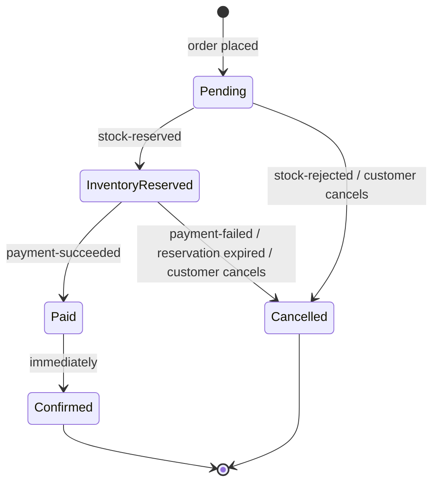

Enforced by the transition table in [Order.cs](../src/services/orders/EcommerceShop.Orders/Domain/Order.cs).

### Stock reservation

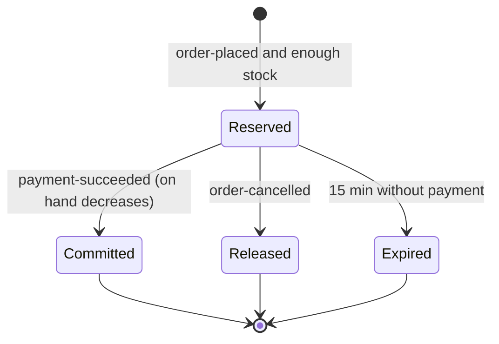

See [service.py](../src/services/inventory/app/service.py).

### Payment

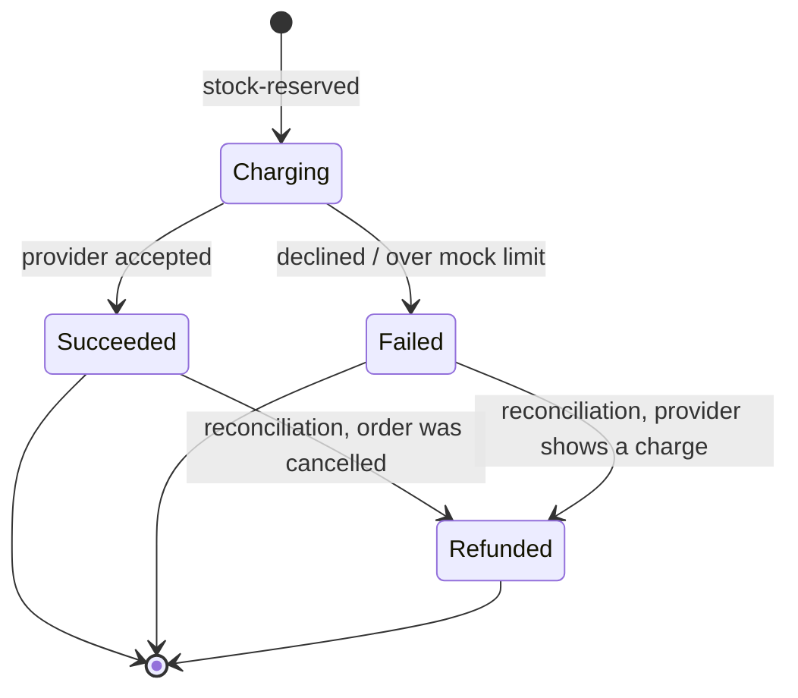

There is one payment per order, enforced by a unique index on `OrderId`
([PaymentsDbContext.cs](../src/services/payments/EcommerceShop.Payments/Data/PaymentsDbContext.cs)).
