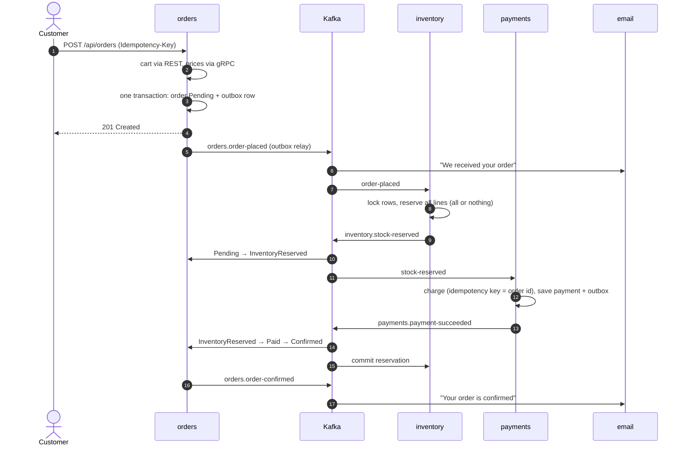
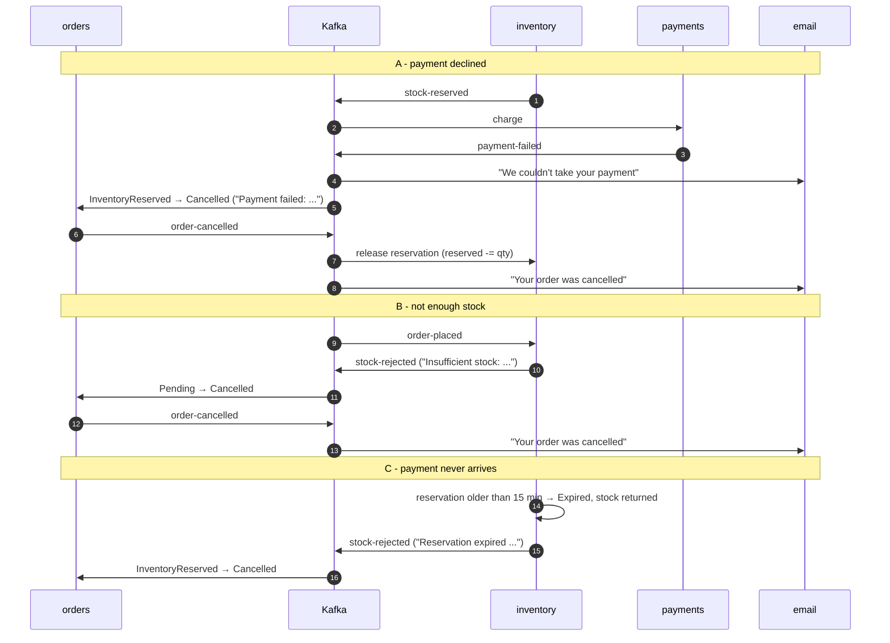

# The order saga

Checkout touches three services that each own their data: orders, inventory and payments. There is
no distributed transaction. Each step commits locally and publishes an event, the next service reacts
to it, and failures are undone by **compensating** steps. The saga is *choreographed* - no service
tells the others what to do - while orders owns the authoritative order state.

## States

| Order status | Meaning | Entered by | Can go to |
|---|---|---|---|
| `Pending` | Order saved, `order-placed` queued in the outbox | `POST /api/orders` | `InventoryReserved`, `Cancelled` |
| `InventoryReserved` | Inventory holds the stock (expires after 15 min) | `inventory.stock-reserved` | `Paid`, `Cancelled` |
| `Paid` | Payment captured | `payments.payment-succeeded` | `Confirmed` |
| `Confirmed` | Terminal - `order-confirmed` published | right after `Paid` | - |
| `Cancelled` | Terminal, with a reason | `stock-rejected`, `payment-failed`, reservation expiry, customer | - |

The allowed transitions are a table in [Order.cs](../src/services/orders/EcommerceShop.Orders/Domain/Order.cs).
Event handling lives in [OrderSagaHandler.cs](../src/services/orders/EcommerceShop.Orders/Application/OrderSagaHandler.cs).
Every transition is written to `order_status_history`, which feeds the timeline on the order page.

| Step | Local transaction | Event out | Compensation if a later step fails |
|---|---|---|---|
| orders: place | order + items + history + outbox row + idempotency key | `order-placed` | cancel the order (`order-cancelled`) |
| inventory: reserve | reservation + `reserved += qty` + inbox row | `stock-reserved` / `stock-rejected` | release the reservation |
| payments: charge | payment record + outbox row + inbox row | `payment-succeeded` / `payment-failed` | refund by reconciliation (`payment-refunded`), see below |
| orders: confirm | status change + outbox row + inbox row | `order-confirmed` | - |
| inventory: commit | `on_hand -= qty`, reservation `Committed` | - | - |

## Happy path



What one real checkout produced (`pm_card_visa`, mock provider, order `963809ee-aabd-42b1-af2e-236cd87c19bf`). Every event has the
same `correlationId`, `0e8c083735dc475fb4900ea986df03f9`:

```text
22:21:04.571  orders.order-placed          7d889651-5464-4009-aa0b-ac027e3baca5
22:21:06.063  inventory.stock-reserved     104e726e-8127-47bd-9f3f-4d131e4efc85
22:21:06.489  payments.payment-succeeded   1c13a752-e54a-45d0-924a-148dd8acbf3a
22:21:08.287  orders.order-confirmed       ed9fdaee-98c3-4839-8318-903396854325
```

The order's timeline afterwards (`GET /api/orders/{id}`):

```json
[
  {
    "from": null,
    "to": "Pending",
    "note": "Order placed",
    "occurredAt": "2023-10-16T22:21:04.569623+00:00"
  },
  {
    "from": "Pending",
    "to": "InventoryReserved",
    "note": "Stock reserved",
    "occurredAt": "2023-10-16T22:21:06.195121+00:00"
  },
  {
    "from": "InventoryReserved",
    "to": "Paid",
    "note": "Payment captured",
    "occurredAt": "2023-10-16T22:21:08.287226+00:00"
  },
  {
    "from": "Paid",
    "to": "Confirmed",
    "note": "Order confirmed",
    "occurredAt": "2023-10-16T22:21:08.287228+00:00"
  }
]
```

## Compensation paths



Path A for real (`pm_card_chargeDeclined`, order `10a33e14-8b8b-48eb-92ff-965735dca9cc`):

```text
22:21:09.060  orders.order-placed          f7a5067b-d6e7-4d21-a401-5cc8edaa45be
22:21:09.999  inventory.stock-reserved     4a0371c8-7f40-4311-9d1c-0109761eaccd
22:21:10.313  payments.payment-failed      ed2e6340-c0ac-49b3-8c50-c298b351877d
22:21:12.358  orders.order-cancelled       6ff7e813-bbb3-46e2-b86b-0974ce60885a
```

```json
{
  "orderId": "10a33e14-8b8b-48eb-92ff-965735dca9cc",
  "paymentId": "f1019ffb-1557-4e0c-9fa3-a9715e38b5cb",
  "userId": "8e3a4d55-2c1b-4f3a-a6d4-7b9c0e1f2a02",
  "email": "customer@ecommerceshop.local",
  "amount": 14.99,
  "reason": "Your card was declined."
}
```

```json
[
  {
    "from": null,
    "to": "Pending",
    "note": "Order placed",
    "occurredAt": "2023-10-16T22:21:09.059925+00:00"
  },
  {
    "from": "Pending",
    "to": "InventoryReserved",
    "note": "Stock reserved",
    "occurredAt": "2023-10-16T22:21:10.012207+00:00"
  },
  {
    "from": "InventoryReserved",
    "to": "Cancelled",
    "note": "Payment failed: Your card was declined.",
    "occurredAt": "2023-10-16T22:21:12.358203+00:00"
  }
]
```

## Failure scenarios

| Scenario | What happens | Where |
|---|---|---|
| Kafka is down when an order is placed | The order and its outbox row are committed. The relay keeps retrying and publishes once Kafka is back. | [OutboxRelay.cs](../shared/EcommerceShop.BuildingBlocks/Messaging/OutboxRelay.cs) |
| An event is delivered twice | Each consumer checks its `processed_events` inbox and skips the duplicate. | [InboxExtensions](../shared/EcommerceShop.BuildingBlocks/Messaging/MessagingExtensions.cs), [handlers.py](../src/services/inventory/app/handlers.py) |
| `payment-succeeded` arrives before `stock-reserved` | Orders throws on purpose. The message goes to `payments.payment-succeeded.retry` and is applied after the reservation. | [OrderSagaHandler.cs](../src/services/orders/EcommerceShop.Orders/Application/OrderSagaHandler.cs) |
| A handler keeps failing (e.g. database down) | `<topic>.retry` with 1s, 2s, 4s… backoff, then `<topic>.dlq`. | [RetryRouting.cs](../shared/EcommerceShop.BuildingBlocks/Kafka/RetryRouting.cs) |
| A malformed message | Straight to `<topic>.dlq`. Retrying won't fix bad data. | [KafkaConsumerService.cs](../shared/EcommerceShop.BuildingBlocks/Kafka/KafkaConsumerService.cs) |
| The customer double-clicks "Place order" | The same `Idempotency-Key` returns the original order (200), not a second one. | [PlaceOrderService.cs](../src/services/orders/EcommerceShop.Orders/Application/PlaceOrderService.cs) |
| Payments processes the same order twice | No second charge: the inbox, the unique `OrderId` index and the Stripe idempotency key (the order id) all stop it. | [PaymentProcessor.cs](../src/services/payments/EcommerceShop.Payments/Application/PaymentProcessor.cs) |
| Catalog or cart is down at checkout | The circuit breaker opens and the API answers 503 problem details quickly. Nothing is saved. | [ResiliencePolicies.cs](../src/services/orders/EcommerceShop.Orders/Clients/ResiliencePolicies.cs) |
| Late events for a cancelled order | Ignored and logged instead of dead-lettered. | `OrderSagaHandler` guards |
| Payment succeeds for an already cancelled order | Orders ignores it. Payments has a copy of the cancellation from `order-cancelled`; its next reconciliation run (every 15 min, or Admin → Reconciliation → Run now) refunds the charge and publishes `payment-refunded`, and email tells the customer. | [ReconciliationService.cs](../src/services/payments/EcommerceShop.Payments/Application/ReconciliationService.cs) |
| `stock-reserved` arrives for an order payments already knows is cancelled | No charge at all - nothing to refund later. | `PaymentProcessor.HandleStockReservedAsync` |
| Our record and the provider's disagree (amount, status, missing charge) | Recorded as a reconciliation issue for a person to look at; nothing is changed automatically. | [ReconciliationService.cs](../src/services/payments/EcommerceShop.Payments/Application/ReconciliationService.cs) |

## Trigger each path locally

Start the stack (`docker compose up --build`), sign in as `customer@ecommerceshop.local` / `Demo@12345`,
and watch the order page - it polls until the saga finishes. Kafka UI (http://localhost:8085) shows
every event; MailHog (http://localhost:8025) shows the emails.

| Path | How |
|---|---|
| Happy path | Add any in-stock product, check out with `4242 4242 4242 4242` (`pm_card_visa`). |
| Payment declined | Check out with `4000 0000 0000 0002` (`pm_card_chargeDeclined`), or `4000 0000 0000 9995` for insufficient funds. |
| Out of stock | Add a sold-out product (e.g. *Card Game: Quick Wits*), or set its stock to 0 in Admin → Inventory first. |
| Mock amount limit | With no Stripe key, an order over $5,000 is declined by the mock provider. |
| Reservation expiry | Set `RESERVATION_TTL_SECONDS=20` in `.env`, then `docker compose stop payments`, place an order and wait. Start payments again afterwards. |
| Customer cancel | Stop payments as above, then use **Cancel order** while the order is still Pending / Stock reserved. |
| Retry and DLQ | `docker compose stop postgres` while an event is in flight, then watch `<topic>.retry` and `<topic>.dlq` fill in Kafka UI. |
| Refund by reconciliation | Set `RESERVATION_TTL_SECONDS=20`, `docker compose stop payments`, place an order and wait until it is cancelled, then start payments. Depending on which event it reads first, payments either skips the charge or charges and the next reconciliation refunds it - run it from Admin → Reconciliation to see the result. |
| Seeded history | Sign in as `jane@ecommerceshop.local`: two confirmed orders and one cancelled after a declined card. |

Inside the Docker network every log line carries the order's `CorrelationId`. In Grafana
(http://localhost:3030 → Explore → Loki), `{service=~".+"} | json | CorrelationId="<id>"` shows one
checkout across all services.

The same from a terminal (gateway on :5000):

```bash
TOKEN=$(curl -s localhost:5000/api/auth/login -H 'Content-Type: application/json' \
  -d '{"email":"customer@ecommerceshop.local","password":"Demo@12345"}' | jq -r .accessToken)

curl -s localhost:5000/api/cart/items -H "Authorization: Bearer $TOKEN" -H 'Content-Type: application/json' \
  -d '{"productId":"c5e86daf-d93e-5727-95ea-bcdc9a873dff","quantity":1}'

curl -s localhost:5000/api/orders -H "Authorization: Bearer $TOKEN" -H 'Content-Type: application/json' \
  -H "Idempotency-Key: $(uuidgen)" \
  -d '{"shippingAddress":{"fullName":"Casey Customer","line1":"1 Main St","city":"Springfield","postalCode":"12345","country":"US"},"paymentMethod":"pm_card_chargeDeclined"}'

# follow the saga
docker compose -f deploy/docker-compose.yml exec kafka kafka-console-consumer.sh \
  --bootstrap-server localhost:9092 --include 'orders\..*|inventory\..*|payments\..*' \
  --property print.headers=true
```

A quick way to see a retry without breaking the database is to pause the mail server, place an
order and look at `orders.order-placed.retry`:

```bash
docker compose -f deploy/docker-compose.yml pause mailhog
# place an order, then after a few seconds:
docker compose -f deploy/docker-compose.yml unpause mailhog
```

Email's copy shows up with `x-consumer-group: email` and `x-retry-count: 1` (full headers in
[design-patterns.md](design-patterns.md#retry-topic-and-dead-letter-topic)). Inventory reads the same
retry topic but skips copies addressed to another group.
